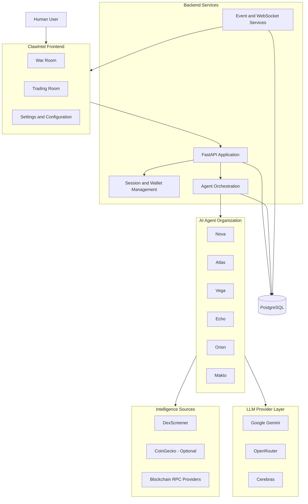

# ClawIntel

### An AI-Powered Cryptocurrency Intelligence Organization

> **We don't hunt scams. We read the chain.**

**Six specialized agents. Two collaborative environments. One shared mission: better cryptocurrency intelligence.**

---

## Table of Contents

- [The Vision](#the-vision)
- [What Is ClawIntel?](#what-is-clawintel)
- [The ClawIntel Organization](#the-clawintel-organization)
- [The Six AI Agents](#the-six-ai-agents)
- [The Two Intelligence Environments](#the-two-intelligence-environments)
- [How ClawIntel Works](#how-clawintel-works)
- [The Intelligence Architecture](#the-intelligence-architecture)
- [Technology Stack](#technology-stack)
- [Market Data and Blockchain Intelligence](#market-data-and-blockchain-intelligence)
- [AI Provider Architecture](#ai-provider-architecture)
- [Demo Wallet and Trading Simulation](#demo-wallet-and-trading-simulation)
- [Real-Time Communication](#real-time-communication)
- [Getting Started](#getting-started)
- [Environment Configuration](#environment-configuration)
- [Development](#development)
- [Current Implementation](#current-implementation)
- [Roadmap](#roadmap)
- [Security and Data Integrity](#security-and-data-integrity)
- [Project Documentation](#project-documentation)
- [Contributing](#contributing)
- [Disclaimer](#disclaimer)

---

# The Vision

Cryptocurrency markets operate continuously.

New tokens emerge, liquidity shifts, wallets move assets, developers deploy contracts, trading activity changes, and market narratives evolve.

Understanding these developments requires looking at several dimensions simultaneously:

- Market activity and emerging opportunities.
- Liquidity conditions and transaction mechanics.
- Smart-contract architecture and permissions.
- Developer, creator, and wallet histories.
- Token distribution and market structure.
- Historical behavior and changing market conditions.

Most traditional platforms present this information through charts, dashboards, scanners, and individual analytical tools.

But information alone is not intelligence.

The real challenge is connecting the information, interpreting it from different perspectives, identifying disagreements, and understanding what the available evidence actually means.

**ClawIntel approaches this problem through collaborative artificial intelligence.**

We envision a future where specialized AI agents operate as an intelligent organization: continuously observing, investigating, exchanging findings, questioning one another, and helping humans understand increasingly complex digital markets.

ClawIntel is our step toward that future.

# What Is ClawIntel?
ClawIntel is an AI-powered, multi-agent cryptocurrency intelligence platform built around a simple idea: complex markets deserve more than a single perspective.

Instead of relying on one AI model to interpret everything, ClawIntel brings together a team of specialized AI agents that observe market activity, investigate digital assets, analyze blockchain evidence, challenge assumptions, debate findings, and collaborate to develop a more complete understanding of the market.

It is designed as an intelligence organization, not just another crypto dashboard or token-scanning tool.
ClawIntel is a multi-agent cryptocurrency intelligence workspace that combines autonomous market observation, specialized blockchain analysis, collaborative reasoning, and human interaction.

The platform is organized into two environments:

**War Room:** An autonomous intelligence environment where agents observe, investigate, exchange findings, challenge one another, and produce collective intelligence.

**Trading Room:** An interactive environment where humans participate directly alongside the agents, discuss market opportunities, investigate assets, explore portfolio workflows, and interact with simulated trading functionality.

Both environments operate within the same broader ClawIntel organization while maintaining their own room-specific agent workers and context.

ClawIntel is designed around five principles:

1. **Specialization:** Each agent brings a distinct area of expertise.
2. **Collaboration:** Agents exchange findings rather than operating as isolated tools.
3. **Challenge:** Agents can question assumptions and disagree when evidence conflicts.
4. **Transparency:** Findings, evidence, limitations, and simulated information should remain distinguishable.
5. **Human participation:** Intelligence should support human understanding and decision-making, not remove human responsibility.

---

# The ClawIntel Organization

ClawIntel operates through six specialized AI agents.

Every agent is a member of the same intelligence organization. Each has an individual identity, expertise, reasoning responsibilities, and contribution to the team's work.

No agent is designed to be universally superior to the others.

Their different responsibilities allow the organization to examine complex situations from multiple perspectives.

The six agents are:

| Agent | Primary Responsibility |
|---|---|
| Nova | Market Intelligence and Discovery |
| Atlas | Transaction Mechanics and Liquidity Analysis |
| Vega | Smart Contract and Market Risk Analysis |
| Echo | Creator, Developer and Wallet Intelligence |
| Orion | Debate Moderation and Intelligence Synthesis |
| Makto | Trading and Portfolio Intelligence |

The agents can collaborate, challenge conclusions, request further investigation, disagree, and revise their positions when new evidence becomes available.

Their personalities make the organization more engaging, but their conclusions must remain grounded in evidence.

## The Six AI Agents

### 1. Nova — Market Intelligence

Nova is responsible for observing the cryptocurrency market and identifying interesting developments.

Nova monitors available market data, identifies emerging activity, and helps the organization understand what is happening across the market.

**Primary responsibilities:**

- Emerging token discovery.
- Market activity observation.
- Liquidity and volume monitoring.
- Market movement analysis.
- Identification of unusual activity and potential opportunities.
- Monitoring tokens submitted for investigation.
- Reporting market changes to other agents.

Nova provides the organization with market awareness and helps determine what deserves closer attention.

### 2. Atlas — Transaction Mechanics and Liquidity

Atlas investigates how transactions actually behave.

Rather than relying only on token descriptions or advertised functionality, Atlas examines the practical mechanics of interacting with digital assets.

**Primary responsibilities:**

- Buy and sell path analysis.
- Transaction feasibility assessment.
- Liquidity depth evaluation.
- Slippage analysis.
- Transaction simulation where supported.
- Execution constraints.
- Exit feasibility and transaction-related risks.

Atlas helps the organization understand whether a transaction is practically executable and what conditions could affect its outcome.

### 3. Vega — Smart Contract and Market Risk

Vega examines the structural and technical characteristics of digital assets.

Her work focuses on understanding what a smart contract allows, how it is configured, and what structural or market risks may exist.

**Primary responsibilities:**

- Contract ownership analysis.
- Proxy and upgradeability detection.
- Minting and administrative permission analysis.
- Blacklist, pause, and transaction restriction checks.
- Fee and tax configuration analysis.
- Liquidity structure examination.
- Holder concentration and token distribution analysis.
- Smart-contract and market risk observations.

Vega distinguishes between verified contract characteristics, potential concerns, and information that cannot be established from the available evidence.

### 4. Echo — Creator, Developer and Wallet Intelligence

Echo investigates the people, wallets, and deployment patterns associated with digital assets where supported data is available.

His responsibility is to provide historical and contextual intelligence that helps the organization understand the background of a project.

**Primary responsibilities:**

- Creator and deployer wallet investigation.
- Wallet transaction history analysis.
- Deployment history examination.
- Previous project and token activity.
- Supported wallet association analysis.
- Historical behavioral pattern identification.
- Developer and creator intelligence.

An unknown identity is not automatically suspicious, and limited historical information is not proof of malicious activity.

Echo focuses on what the available evidence establishes.

### 5. Orion — Debate Moderator and Intelligence Synthesizer

Orion helps coordinate the visible intellectual discussion inside the intelligence rooms.

He guides discussions, identifies disagreements, encourages agents to challenge one another, and brings the team's findings together.

Orion is not the backend agent orchestrator. He is a visible member of the agent team with a responsibility for debate moderation and collective reasoning.

**Primary responsibilities:**

- Moderating agent discussions.
- Identifying conflicting findings.
- Encouraging evidence-based challenges.
- Highlighting missing information.
- Requesting additional analysis when necessary.
- Evaluating competing interpretations.
- Producing a final synthesized assessment.

Orion does not simply repeat what the other agents say. His responsibility is to understand their individual contributions and explain how they fit together.

### 6. Makto — Trading and Portfolio Intelligence

Makto contributes trading and portfolio expertise to the ClawIntel organization.

Makto works with the available wallet, portfolio, market, and trading information to help users understand their simulated trading activity and explore trading workflows.

**Primary responsibilities:**

- Demo portfolio monitoring.
- Position and balance awareness.
- Position-sizing calculations.
- Trade workflow assistance.
- Simulated trade execution.
- Portfolio activity tracking.
- Trading-related communication with the other agents.

Makto collaborates with the same team and follows the same evidence, permission, and safety principles as every other agent.

---

# The Two Intelligence Environments

ClawIntel provides two different environments for experiencing its multi-agent organization.

They serve different purposes but belong to the same platform.

## 1. War Room — Autonomous Intelligence

The War Room is the autonomous intelligence environment of ClawIntel.

It is designed for observation rather than direct conversation with the user.

Agents operate within a shared intelligence environment, publishing their findings, exchanging information, challenging interpretations, and contributing to investigations.

The user watches the organization work.

**Key characteristics:**

- Autonomous market observation.
- Agent-led investigations.
- Individual agent contributions.
- Collaborative discussions.
- Evidence-based challenges and rebuttals.
- Visible disagreement between agents.
- Investigation progress and status updates.
- Collective intelligence synthesis.
- A persistent intelligence activity feed.

### Agent Debate

The War Room is not simply a list of AI-generated reports.

Agents can have different interpretations of the same evidence.

For example:

- Nova may identify unusual market activity.
- Vega may examine the contract structure.
- Atlas may question whether the available liquidity supports meaningful execution.
- Echo may investigate the creator's previous activity.
- Orion may identify disagreements and request additional analysis.
- The agents may revise their positions when new information becomes available.

The result is a collaborative intelligence process rather than a single model producing an unquestioned answer.

The agents are allowed to have personalities. They can challenge one another, disagree, make humorous remarks, and occasionally argue.

However, personality never replaces evidence.

**The War Room is where ClawIntel thinks together.**

## 2. Trading Room — Human-AI Collaboration

The Trading Room brings the human into the intelligence organization.

Unlike the autonomous War Room, this environment allows users to interact directly with the agents.

Users can discuss markets, submit token addresses for investigation, introduce information, ask questions, and explore simulated trading and portfolio workflows.

The Trading Room includes the same core agent team, with Makto contributing trading and portfolio expertise.

**Key characteristics:**

- Interactive AI conversations.
- Human-led investigation requests.
- Token and market discussions.
- Agent-to-agent collaboration.
- Agent responses to user-provided information.
- Simulated NEAR wallet integration.
- Demo portfolio monitoring.
- Simulated trading workflows.
- Trading-related discussions and analysis.

### A Living Intelligence Team

The Trading Room is designed to feel like an actual collaborative environment.

Agents should not behave like disconnected customer-support bots.

They can:

- Challenge the user's assumptions.
- Disagree with another agent's analysis.
- Ask for missing information.
- Discuss findings with one another.
- Question unrealistic trading decisions.
- Respond naturally to the user's comments.
- Use humor and personality without compromising analytical quality.

For example, if a user proposes a trade that exceeds the available demo wallet balance, the team can point that out naturally.

The objective is to create an engaging environment where users interact with an intelligent team rather than repeatedly asking isolated questions to a chatbot.

**The Trading Room is where humans work alongside ClawIntel.**

---

# How ClawIntel Works

ClawIntel combines market-data collection, specialized analysis, agent collaboration, and intelligence delivery.

At a high level, the workflow follows this structure:

1. **Observation:** The platform collects available market and blockchain information.
2. **Discovery or Submission:** An asset or market development becomes a subject for investigation.
3. **Investigation:** Relevant agents examine the information from their individual areas of expertise.
4. **Evidence Collection:** Available market, contract, transaction, and wallet information is gathered.
5. **Collaboration:** Agents exchange findings and identify conflicting interpretations.
6. **Challenge and Reassessment:** Agents question conclusions and request additional analysis when necessary.
7. **Synthesis:** Orion brings the team's findings together into a collective assessment.
8. **Delivery:** Results and agent contributions are published to the appropriate intelligence environment.

This is a conceptual description of the intended intelligence workflow. The depth of investigation depends on the available data sources, configured providers, and implemented agent capabilities.

## Backend Orchestration

Behind the visible agents is a backend orchestration service.

This is infrastructure, not another AI personality.

Its responsibilities include:

- Opening investigations.
- Selecting the appropriate room-specific workers.
- Managing agent execution.
- Tracking investigation status.
- Handling timeouts and retries.
- Persisting investigation events.
- Publishing agent contributions.
- Managing investigation lifecycle.
- Invoking synthesis at the appropriate stage.

Each agent remains responsible for its own contribution.

The orchestrator manages the process; it does not replace the agents or become another visible member of the team.

---

# The Intelligence Architecture

ClawIntel uses a modular architecture designed to separate the user interface, backend services, agent execution, data collection, AI providers, and persistent storage.

## High-Level Architecture



The diagram represents the main architectural components. Actual execution depends on the configured services and implemented workflows.

## Department Isolation

War Room and Trading Room use separate room-specific worker contexts.

This separation supports:

- Independent agent activity.
- Department-specific conversations.
- Separate LLM provider settings.
- Room-aware event delivery.
- Different interaction permissions.
- Independent operational workflows.

The agents share the broader organizational identity and specialties, but their room-specific execution contexts are not intended to be one shared conversation.

## Backend

The backend is responsible for application logic, API requests, agent execution, data persistence, wallet workflows, and real-time communication.

Core technologies include:

- Python 3.12.
- FastAPI.
- Pydantic.
- SQLAlchemy 2.x with asynchronous database access.
- Alembic migrations.
- PostgreSQL.

## Frontend

The frontend provides the visual and interactive experience.

Core technologies include:

- React 19.
- TypeScript.
- Vite.
- Tailwind CSS.
- React Router.
- TanStack Query.
- Lucide icons.
- Framer Motion.

## Database

ClawIntel uses PostgreSQL as its current persistent database.

It supports the storage of application data, sessions, investigation events, agent activity, and simulated trading records.

Database schema changes are managed through Alembic migrations.

The current architecture does not automatically migrate the historical MongoDB database used by the earlier version of the project.

---

# Technology Stack

| Layer | Technology |
|---|---|
| Backend Language | Python 3.12 |
| API Framework | FastAPI |
| Data Validation | Pydantic |
| ORM | SQLAlchemy 2.x |
| Database | PostgreSQL |
| Database Migrations | Alembic |
| Frontend Framework | React 19 |
| Frontend Language | TypeScript |
| Build Tool | Vite |
| Styling | Tailwind CSS |
| Routing | React Router |
| Server State | TanStack Query |
| Icons | Lucide |
| UI Motion | Framer Motion |
| Real-Time Communication | WebSockets |
| AI Provider Integration | Gemini, OpenRouter, Cerebras |
| Market Data | DexScreener |
| Optional Market Enrichment | CoinGecko |
| Blockchain Information | Chain-specific RPC providers |
| Deployment and Local Services | Docker Compose |

---

# Market Data and Blockchain Intelligence

ClawIntel is designed to combine information from different sources rather than depend on one data provider.

## Current Data Sources

### DexScreener

Used for market-pair information and available token market data.

The current autonomous scan uses DexScreener to retrieve market information.

### CoinGecko

Optional market-data enrichment when a valid API key is configured.

### Blockchain RPC Providers

The application supports configured RPC endpoints for retrieving basic blockchain account and code information.

Current supported RPC configuration includes:

- Ethereum.
- BNB Chain.
- Base.
- Solana.

The availability and depth of returned information depend on the configured provider and the chain-specific integration.

### Evidence and Limitations

ClawIntel is designed to pass retrieved information to the relevant analysis processes as evidence.

The AI agents should not invent unavailable information or present missing data as verified findings.

For example:

- The presence of contract bytecode is not a complete smart-contract audit.
- An unknown wallet identity does not establish malicious activity.
- A low-liquidity pool is not, by itself, proof of fraud.
- A simulated transaction is not equivalent to a confirmed blockchain transaction.

These distinctions are important to maintaining reliable intelligence.

---

# AI Provider Architecture

ClawIntel supports a modular LLM provider architecture.

The current provider integrations include:

- Google Gemini.
- OpenRouter.
- Cerebras.

Provider adapters allow the application to communicate with different model services through a consistent internal interface.

## Independent Department Configuration

War Room and Trading Room have independent provider configurations.

This allows the two environments to use different provider priorities and model configurations.

The architecture supports provider fallback where configured.

However, provider fallback must not be confused with guaranteed availability. If configured providers fail, the application should report the failure rather than silently pretend that a successful AI response was generated.

## Provider Transparency

ClawIntel aims to make provider failures visible.

When an LLM provider is unavailable or improperly configured, the application should report the issue.

It should not substitute scripted text and represent it as genuine model-generated reasoning.

This distinction is especially important when evaluating agent behavior.

---

# Demo Wallet and Trading Simulation

The Trading Room includes a simulated NEAR wallet environment.

This provides a controlled way to explore wallet-connected workflows and simulated trading without requiring users to risk real cryptocurrency.

## Current Demo Wallet Behavior

The current implementation supports:

- Session-scoped simulated wallet addresses.
- An initial demo balance of 1,000 NEAR.
- Backend-enforced wallet access.
- Simulated portfolio records.
- Controlled quote generation.
- User approval or rejection of quotes.
- Simulated trade execution.
- PostgreSQL-backed ledger updates.

## Current Quote Fixtures

The existing quote workflow supports the following controlled fixture tokens:

- `demo:claw`
- `demo:signal`

These operate on the `demo` chain using controlled fixture prices.

Quotes expire after 30 seconds.

When a user approves a quote, the backend updates the simulated balance and records the simulated trade and associated fee.

## Important Trading Limitations

The current wallet is a simulation.

It does not provide:

- Real NEAR wallet custody.
- Private-key storage.
- Real wallet signing.
- Real NEAR account balances.
- NEAR RPC transaction broadcasting.
- Actual blockchain trade execution.

The simulated trading environment must not be represented as live on-chain trading.

Future work may expand the trading engine, quote sources, exit workflows, and real-market valuation capabilities.

---

# Real-Time Communication

ClawIntel uses persistent event records and WebSocket communication to deliver activity to the frontend.

This allows the application to publish:

- Agent messages.
- Investigation updates.
- Department-specific events.
- Status changes.
- Other intelligence activity.

Events are persisted in PostgreSQL before being delivered through the appropriate department or session-aware WebSocket channel.

This architecture provides a foundation for reliable, observable communication between the backend and the user interface.

Further work remains around missed-event replay, deduplication, and more comprehensive delivery guarantees.

---

# Getting Started

The following instructions describe the current Docker-based development setup.

## Prerequisites

Install the following:

- Docker Desktop with Docker Compose.
- Node.js 20.19+ or 22.12+.
- Python 3.12 if running the backend outside Docker.

You will also need API credentials for whichever AI providers and optional data sources you intend to use.

## 1. Clone the Repository

```bash
git clone https://github.com/sediq247/Claw-Intel.git

cd Claw-Intel
```

## 2. Configure Environment Variables

Copy the example environment file:

```bash
cp .env.example .env
```

On Windows PowerShell:

```powershell
Copy-Item .env.example .env
```

Open `.env` and configure the credentials and settings you need.

Do not commit your `.env` file or expose API keys publicly.

## 3. Start ClawIntel

From the project root:

```bash
docker compose up --build
```

Docker Compose starts the configured application services.

Database migrations are expected to run before the API becomes available.

## 4. Open the Application

Once the services are running, open:

```text
http://localhost:6548
```

The health endpoint is available at:

```text
http://localhost:6548/health
```

The health endpoint provides application and database connectivity information and configured provider status without exposing secret credentials.

---

# Environment Configuration

The `.env.example` file is the source of truth for the supported environment variables.

Depending on your setup, configuration may include:

| Configuration | Purpose |
|---|---|
| Database settings | PostgreSQL connectivity |
| Gemini settings | Google Gemini integration |
| OpenRouter settings | OpenRouter integration |
| Cerebras settings | Cerebras integration |
| War Room provider settings | War Room provider priorities and model selection |
| Trading Room provider settings | Trading Room provider priorities and model selection |
| Ethereum RPC | Ethereum blockchain information |
| BNB Chain RPC | BNB Chain information |
| Base RPC | Base blockchain information |
| Solana RPC | Solana blockchain information |
| CoinGecko API key | Optional market-data enrichment |
| Application origins | Allowed frontend origins |

Provider and model configuration names should be copied directly from `.env.example`.

Do not assume that every provider or external data source is mandatory.

---

# Development

Developers who prefer running the frontend and backend independently can use the following setup.

## Backend

Install dependencies:

```bash
python -m pip install -r requirements.txt
```

Run database migrations:

```bash
alembic upgrade head
```

Start the API:

```bash
uvicorn backend.app.main:app --reload --port 8000
```

## Frontend

Open a separate terminal:

```bash
cd frontend
```

Install dependencies:

```bash
npm install
```

Start the development server:

```bash
npm run dev
```

The Vite development server uses port `6548` and proxies `/api` and `/ws` to the backend running on port `8000`.

Configure `ALLOWED_ORIGINS` to include:

```text
http://localhost:6548
```

## Compatibility Entry Points

The repository also includes compatibility entry points:

```bash
python server_main.py
```

```bash
python agents_main.py
```

These are compatibility entry points for the combined API and autonomous-worker process.

Do not start multiple duplicate worker loops for the same application instance.

---

# Current Implementation

ClawIntel is an actively evolving project.

It is important to distinguish between existing functionality, controlled simulations, and planned capabilities.

## Implemented Foundation

The current rebuild includes:

- PostgreSQL database foundation.
- Initial database migrations.
- Browser-session management.
- Backend-enforced demo wallet access.
- Department-scoped event persistence.
- WebSocket event delivery.
- Independent LLM provider settings for both departments.
- Gemini, OpenRouter, and Cerebras provider integrations.
- Visible provider failure handling.
- React application shell.
- Read-only War Room foundation.
- Interactive Trading Room foundation.
- Simulated NEAR wallet.
- Fixture-based quote generation.
- Quote approval and rejection.
- Simulated portfolio ledger.
- Repeatable simulated War Room investigation scenarios.
- Bounded autonomous DexScreener market scanning.
- Optional CoinGecko enrichment.
- Configured chain RPC enrichment.

## Simulated Capabilities

Some capabilities use deterministic test scenarios rather than live market intelligence.

These include controlled War Room investigation scenarios such as:

- Suspicious token.
- Potential opportunity.

Their generated evidence and findings are simulated.

They are useful for testing agent workflows and the user interface, but they must not be presented as genuine discoveries from live market conditions.

## Work in Progress

The following areas require further development and verification:

- Broader autonomous market discovery.
- Migration of historical analyzer and watcher business logic.
- More comprehensive creator and deployer intelligence.
- Persisted evidence-to-debate relationships.
- Dynamic conflict and debate revisions.
- More advanced agent-specific memory.
- Deeper Atlas-to-Makto trading workflow integration.
- Expanded trading risk models.
- Sell and exit workflows.
- Real-market portfolio valuation.
- External holder and deployer intelligence integrations.
- Per-department AI usage and cost tracking.
- Multi-user authentication for public deployments.
- Missed-event replay and deduplication improvements.
- Comprehensive accessibility and security audits.
- Broader frontend and integration testing.
- PostgreSQL-backed end-to-end verification.
- Production deployment validation.
- Reviewed migration tooling for historical MongoDB data.

The presence of a feature in the roadmap does not mean it is already implemented.

---

# Roadmap

Our long-term development direction includes several areas.

## Intelligence Development

- Expand autonomous market observation.
- Improve multi-chain discovery.
- Increase investigation depth.
- Introduce richer historical intelligence.
- Improve evidence collection and source traceability.

## Agent Collaboration

- Develop more advanced agent-to-agent communication.
- Improve persistent agent memory.
- Support dynamic debate revisions.
- Improve disagreement detection.
- Strengthen evidence-based reasoning.
- Expand the team's ability to request and conduct additional investigations.

## Trading Room

- Expand supported market data.
- Improve quote and execution analysis.
- Develop more complete portfolio workflows.
- Expand simulated buy and sell operations.
- Improve position-sizing and risk calculations.
- Explore additional wallet integration possibilities.

## Platform Engineering

- Strengthen authentication and authorization.
- Improve multi-user isolation.
- Expand observability.
- Improve event replay and delivery reliability.
- Expand automated testing.
- Improve deployment and operational security.

Our objective is to build an intelligence organization that becomes more capable through better evidence, better collaboration, and more reliable engineering.

---

# Security and Data Integrity

Security and trustworthy information are important design principles.

ClawIntel's architecture includes several safeguards:

- Backend-enforced Trading Room wallet access.
- Session-scoped simulated wallet state.
- Server-side quote approval and ledger updates.
- Environment-based secret configuration.
- PostgreSQL persistence.
- Database migrations through Alembic.
- Department-aware event delivery.
- Visible LLM provider failure handling.
- Explicit distinction between simulated and retrieved evidence.

## Database Safety

The current PostgreSQL database is managed through Alembic migrations.

Avoid using:

```python
Base.metadata.create_all()
```

against a deployed database as a substitute for proper migrations.

Do not delete the `clawintel_postgres` Docker volume to reset the database unless you intentionally want to destroy its stored data and have appropriate backups.

The historical MongoDB database is not automatically imported into the current PostgreSQL system.

Any migration from the previous database should involve a reviewed export, transformation, backup, and explicit import process.

---

# Project Documentation

Additional technical documentation is maintained in the repository.

| Document | Purpose |
|---|---|
| `docs/ARCHITECTURE.md` | System architecture and component relationships |
| `docs/REPOSITORY_AUDIT.md` | Repository review and implementation observations |
| `docs/RESEARCH_AND_TECHNICAL_DECISIONS.md` | Technical research and architectural decisions |
| `.env.example` | Environment configuration reference |

These documents complement this README with deeper engineering details.

---

# Contributing

ClawIntel is an evolving project, and contributions that improve its reliability, intelligence capabilities, and user experience are welcome.

Areas where contributions may be valuable include:

- AI agent development.
- Blockchain integrations.
- Market-data integrations.
- Backend engineering.
- Frontend development.
- Agent orchestration.
- Database engineering.
- Testing and quality assurance.
- Security engineering.
- Documentation.

When contributing:

1. Understand the existing architecture before making structural changes.
2. Keep agent responsibilities clearly defined.
3. Preserve the separation between War Room and Trading Room.
4. Avoid presenting simulated functionality as live functionality.
5. Keep secrets out of source control.
6. Use database migrations for schema changes.
7. Include appropriate tests for new functionality.
8. Document significant architectural decisions.

---

# Disclaimer

ClawIntel is an experimental cryptocurrency intelligence and research platform.

Information and assessments generated by its AI agents are provided for informational and educational purposes only.

Nothing produced by ClawIntel constitutes financial advice, investment advice, or a guarantee of future market performance.

Market data may be incomplete, delayed, inaccurate, or unavailable. AI-generated assessments may contain errors.

Simulated wallet balances, quotes, and trades do not represent real cryptocurrency holdings or confirmed blockchain transactions.

Users are responsible for independently verifying information and making their own financial decisions.

Always conduct your own research and understand the risks associated with digital assets.

---

# Project Links

**GitHub Repository:**  
https://github.com/sediq247/Claw-Intel

**Project Website:**  
https://clawintel-page.vercel.app

---

# The Future of Cryptocurrency Intelligence

We believe the future of cryptocurrency intelligence will be collaborative.

Not one model trying to know everything.

Not another dashboard filled with numbers.

But specialized intelligence systems that observe, investigate, reason, challenge, and learn to work together.

A team where different perspectives matter. Where conclusions can be questioned. Where evidence matters more than confidence. And where humans remain part of the process.

That is the idea behind ClawIntel.

**Six agents. Different minds. One intelligence organization.**

*Built with precision. Operates with purpose. Never stops learning.*

**ClawIntel © 2026**